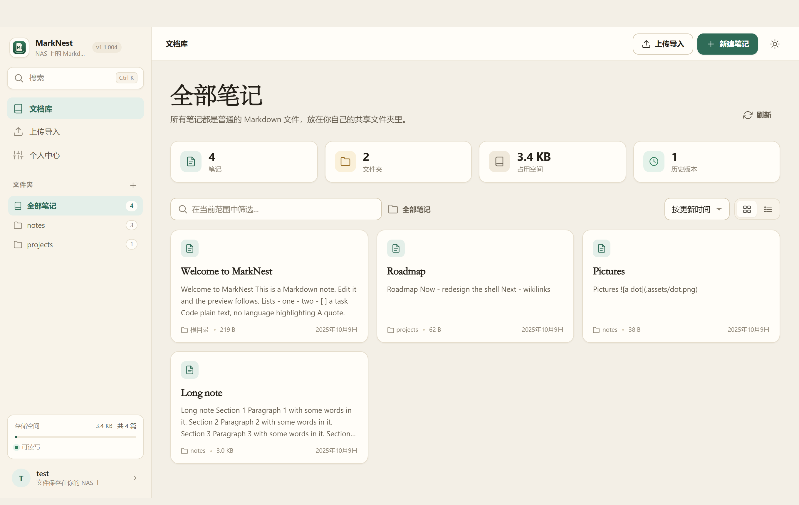
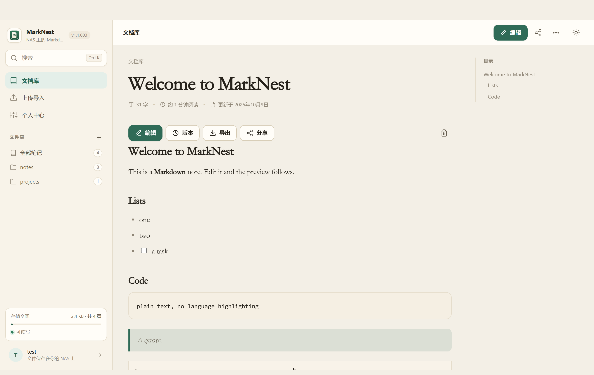
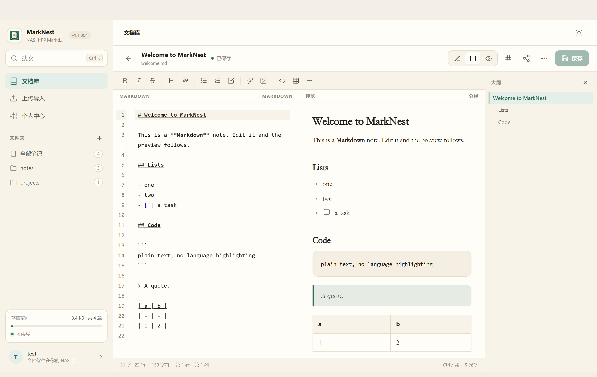
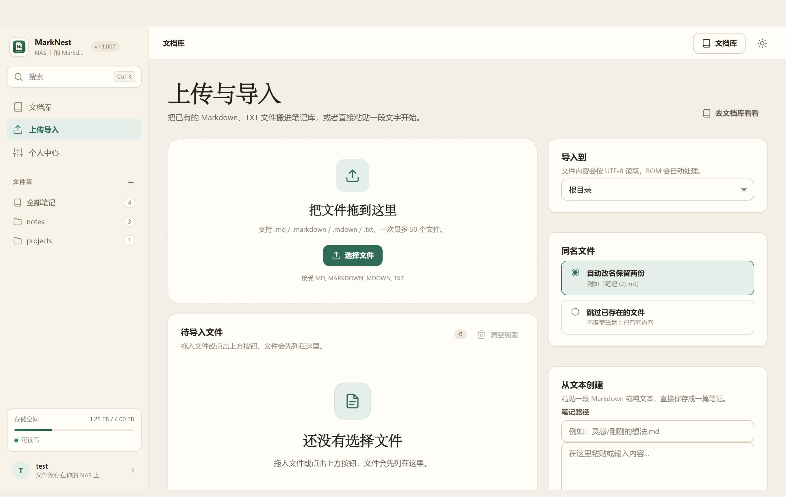
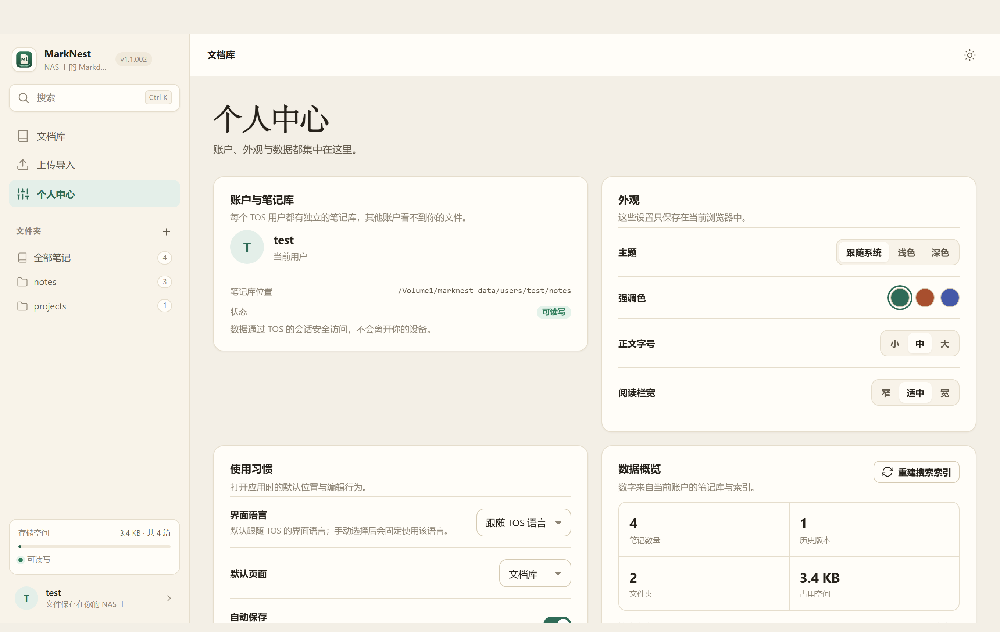
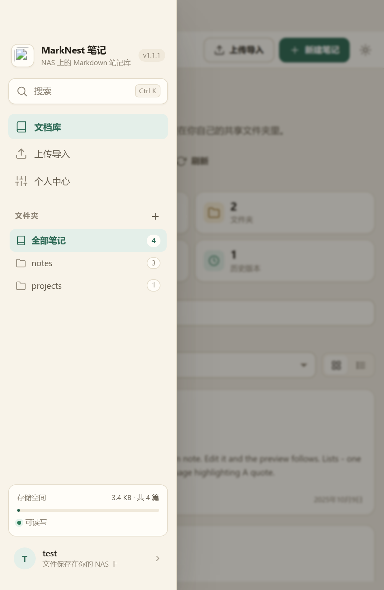

# MarkNest

**把笔记以普通 `.md` 文件保存在 NAS 共享文件夹里的 TOS 7 应用。**


MarkNest 不是又一个把内容锁进数据库的笔记服务。它把每一篇笔记都写成共享文件夹里的普通 Markdown 文件，自己只做浏览、编辑与索引。因此这些笔记同时属于你常用的所有工具：文件管理器里直接打开、通过 SMB 拷走、由卷快照保留历史版本、用任意编辑器或脚本处理。



## 功能

**五个页面，一条完整的写作路径**

- **文档库**：按文件夹树浏览笔记，卡片上直接看到摘要、大小与更新时间；支持网格/列表切换、按名称或时间排序、当前范围过滤，以及跨全部笔记的全文搜索（`Ctrl K`）。左侧边栏宽度可以拖动调节，并记住你的选择；存储卡片显示 NAS 卷的已用/总容量与剩余空间。「从 NAS 打开」可直接浏览共享文件夹里的目录并打开笔记。
- **阅读页**：排版后的正文、标题大纲、上一篇/下一篇，以及导出与分享入口。
- **编辑页**：分栏 Markdown 编辑器，左侧写作、右侧实时预览并同步滚动。工具栏快捷插入标题、粗体、斜体、链接、引用、代码块、列表与表格；大纲面板可跳转到任意标题；图片可直接上传或粘贴插入。
- **上传与导入页**：批量导入 `.md` 文件，逐文件给出结果，失败的原因会被说明而不是静默跳过。
- **个人中心/设置**：深色主题、正文字体与字号、默认首页、语言等个人偏好；界面语言默认跟随 TOS 的显示语言，也可以手动固定。

**写作时被认真对待的细节**

- 保存时带上文件版本，检测到别处改过同一篇笔记就提示冲突，而不是覆盖。
- 每次保存留下历史版本，可以回看与恢复。
- 笔记以纯文本保存，图片放在笔记旁边的附件目录里，链接保持相对路径，整个文件夹搬走也不会坏。
- 每位 TOS 用户拥有独立的笔记库，彼此不可见。

## 界面

| 文档库 | 阅读 |
| --- | --- |
|  |  |

| 编辑 | 导入 |
| --- | --- |
|  |  |

| 设置 | 窄屏抽屉 |
| --- | --- |
|  |  |

截图使用演示数据，仅用于展示界面。

## 安装

1. 打开 [Releases](https://github.com/Irvingfei/MarkNest/releases) 页面，按 NAS 的 CPU 架构下载安装包：
   - Intel / AMD：`marknest_<版本>_x86_64.deb`
   - ARM：`marknest_<版本>_aarch64.deb`
2. 在 TOS 桌面打开**应用中心**，选择手动安装，上传对应的 `.deb`。
3. 安装完成后，桌面出现 **MarkNest** 图标。

同目录下的 `.sha256` 文件可用于校验下载完整性。

**系统要求**：TOS 7.0 及以上；Python 3.10 及以上（TOS 7 自带）；无需联网即可使用。

## 数据在哪里

安装时应用会创建一个名为 **`marknest-data`** 的共享文件夹（通常在 `/Volume1/marknest-data`）：

```text
marknest-data/
└── users/
    ├── alice/notes/**/*.md
    └── bob/notes/**/*.md
```

- 该文件夹会出现在文件管理器中，也自动通过 SMB 共享，可以直接用系统工具打开或备份。
- 全文搜索索引是派生缓存，存放在应用目录而非共享文件夹；删掉只会触发一次重建，不会丢失笔记。
- **卸载应用不会删除 `marknest-data`**。笔记是你自己的文件，这个文件夹需要由你决定何时清理。
- 应用不访问其它共享文件夹，也不向外部服务发送内容。

## 从源码构建

构建只需要 Python 3.10+ 和标准库；Node 仅在需要修改编辑器时用于重新打包 CodeMirror。

```bash
python tools/build.py --platform x86_64    # 产物：dist/marknest_x86_64.deb
python tools/build.py --platform aarch64   # 产物：dist/marknest_aarch64.deb
```

版本号的唯一事实来源是根目录的 `VERSION`，修改前端资源后请先递增版本再构建，以刷新浏览器缓存：

```bash
python tools/bump_version.py --bump patch
```

质量门禁（提交前建议全部通过）：

```bash
python tools/validate.py        # 安装包、元数据与权限检查
python tools/lang_stats.py      # 14 种语言元数据完整性
python tools/bump_version.py --check
node tools/webui_check.js       # 九语字典键一致性
python tools/verify_pages.py    # 无头浏览器逐页验收
```

更多实现细节见 [开发文档](docs/开发文档.md) 与 [上架与审核](docs/上架与审核.md)。

## 语言

界面提供简体中文、繁體中文、English、日本語、한국어、Deutsch、Français、Español 与 Русский 九种语言，默认跟随 TOS 的显示语言，并在 TOS 语言变化后自动切换；其余语言回退到 English。应用中心的名称、简介与更新说明提供 14 种语言。

## 反馈

- 问题与建议：[Issues](https://github.com/Irvingfei/MarkNest/issues)
- 版本下载：[Releases](https://github.com/Irvingfei/MarkNest/releases)

---

**English** — MarkNest is a Markdown note library for TerraMaster TOS 7 that keeps every note as an ordinary `.md` file in a shared folder on the NAS. Browse notes as a tree, edit them in a split-pane editor with live preview, and search across the whole library. Because the notes are plain files, they also work from the File Manager, over SMB, and with volume snapshots. Download the package for your architecture from [Releases](https://github.com/Irvingfei/MarkNest/releases), then install it from the TOS App Center.
